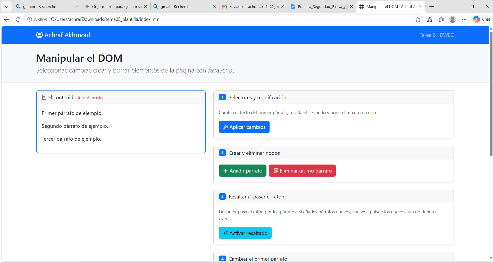
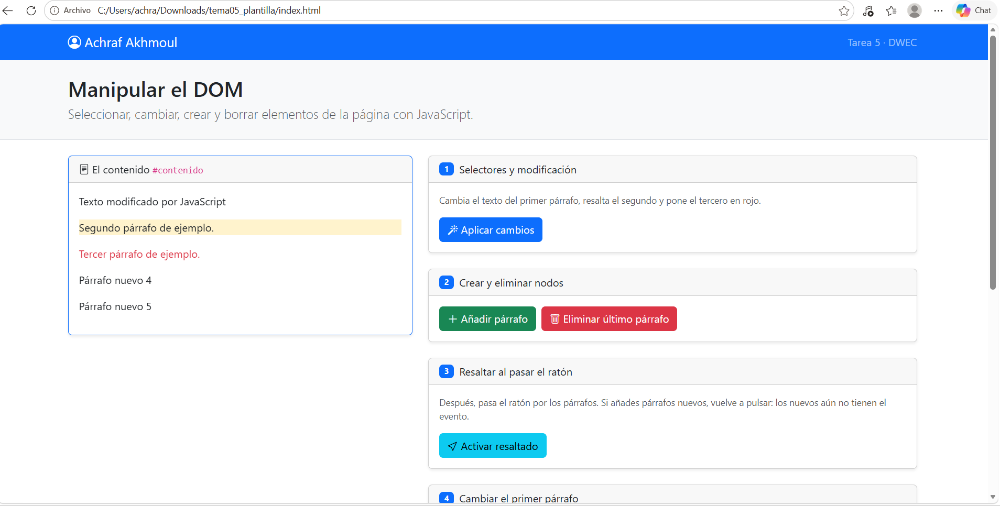
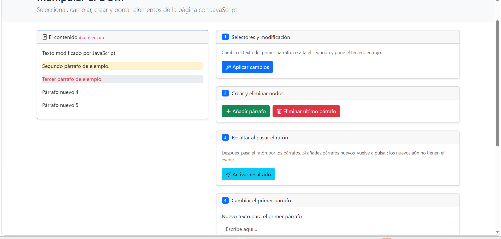
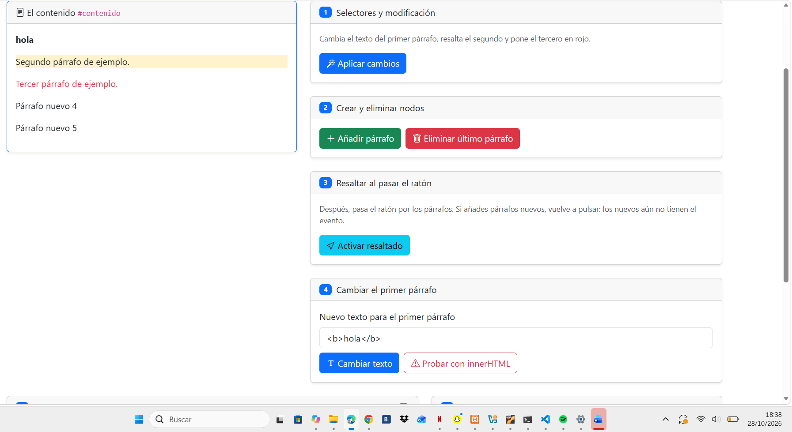
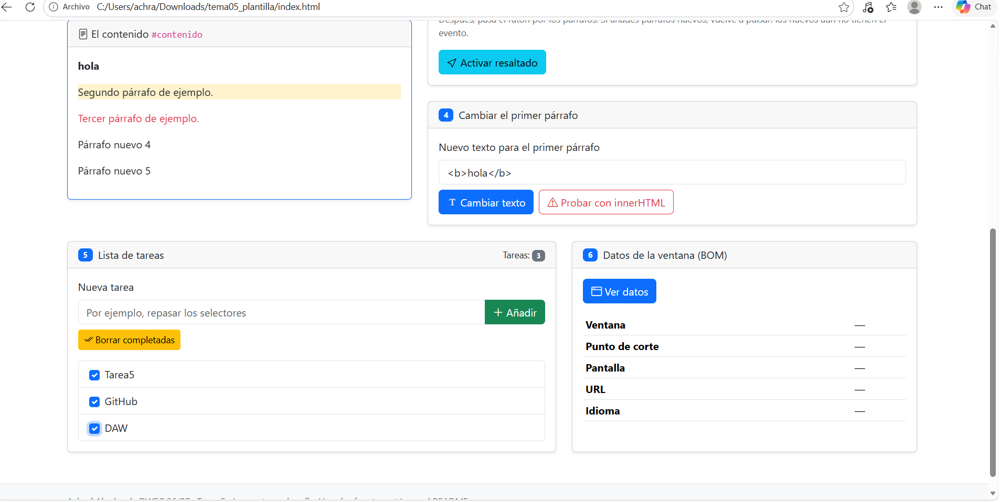
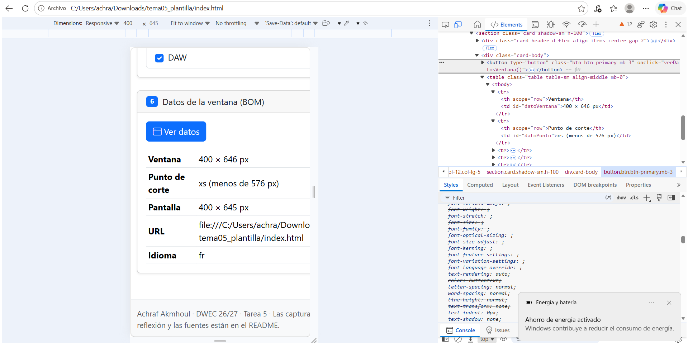

# Tarea 5 · Manipular el DOM

**Autor:** Achraf Akmhoul · Desarrollo Web en Entorno Cliente (DWEC) · 2.º DAW · Curso 2026-27

En esta carpeta se encuentra el proyecto de la Tarea 5 donde se manipula el DOM mediante JavaScript dinámico. Para probar la página, abre la carpeta en VS Code, inicia la extensión **Live Server** (o pulsa *Go Live*) y abre las herramientas de desarrollo del navegador (F12) para comprobar las trazas en la consola mientras interactúas con los botones.

## Capturas

### a) La página recién cargada

Página principal cargada inicialmente mostrando el encabezado, la barra de navegación con mi nombre (Achraf Akmhoul) y los tres párrafos iniciales de ejemplo dentro del contenedor `#contenido`.

### b) Ejercicios 1 y 2

Resultado tras aplicar el Ejercicio 1 y 2: el primer párrafo cambia su texto mediante `getElementById()`, el segundo se resalta en amarillo (`bg-warning-subtle`) con `querySelector('.segundo')`, el tercero pasa a texto rojo (`text-danger`) usando `querySelectorAll()`, y se han añadido dinámicamente dos nuevos párrafos numerados con `createElement()` y `append()`.

### c) Ejercicio 3: resaltado al pasar el ratón

Al mover el cursor sobre los párrafos, estos cambian temporalmente a fondo gris (`bg-body-secondary`) por el evento `mouseenter` y vuelven a su estado original al salir con `mouseleave`. Si se añaden párrafos nuevos con el Ejercicio 2, hay que volver a pulsar el botón "Activar resaltado" para asociarles los escuchadores de eventos.

### d) Ejercicio 4: `<b>hola</b>` con innerHTML

Comparativa del Ejercicio 4: al usar "Cambiar texto" (`textContent`), el texto `<b>hola</b>` se muestra literalmente en pantalla como código en texto plano; mientras que con "Probar con innerHTML" (`innerHTML`), el navegador interpreta las etiquetas HTML y renderiza la palabra **hola** en negrita.

### e) Ejercicio 5: la lista de tareas

Lista de tareas interactiva con tres elementos añadidos mediante `createElement()`, una casilla marcada y el contador dinámico `#totalTareas` reflejando 3 tareas. Al pulsar "Borrar completadas", se elimina el elemento `<li>` correspondiente a la casilla marcada usando `parentElement`.

### f) Ejercicio 6: los datos de la ventana en el móvil

Muestra de la tabla del BOM ajustada con el modo dispositivo de la consola (F12) en emulación móvil. Se observa el ancho reducido de la ventana y el cálculo automático del punto de corte responsive de Bootstrap a `xs (menos de 576 px)`, a diferencia de la resolución de escritorio que marcaba `xl` o `xxl`.

## Reflexión

La diferencia fundamental entre `textContent` e `innerHTML` radica en cómo procesan el contenido. La propiedad `textContent` trata la cadena asignada estrictamente como texto plano, escapando cualquier carácter especial, mientras que `innerHTML` parsea e interpreta la cadena como código HTML. Al probar a introducir `<b>hola</b>`, con `textContent` se muestran literalmente las etiquetas en pantalla, mientras que con `innerHTML` la palabra se renderiza en negrita. Asignar directamente a `innerHTML` texto introducido por el usuario es una práctica peligrosa porque abre la puerta a vulnerabilidades de seguridad como Cross-Site Scripting (XSS). Un usuario malintencionado podría inyectar scripts ejecutables (por ejemplo, etiquetas `<script>` o atributos como ``) para ejecutar código arbitrario, robar cookies o comprometer la sesión de otros usuarios.

## Fuentes

- [MDN Web Docs - Document Object Model (DOM)](https://developer.mozilla.org/es/docs/Web/API/Document_Object_Model)
- [MDN Web Docs - Element.textContent](https://developer.mozilla.org/es/docs/Web/API/Node/textContent)
- [Bootstrap 5 Documentation - Breakpoints](https://getbootstrap.com/docs/5.3/layout/breakpoints/)

